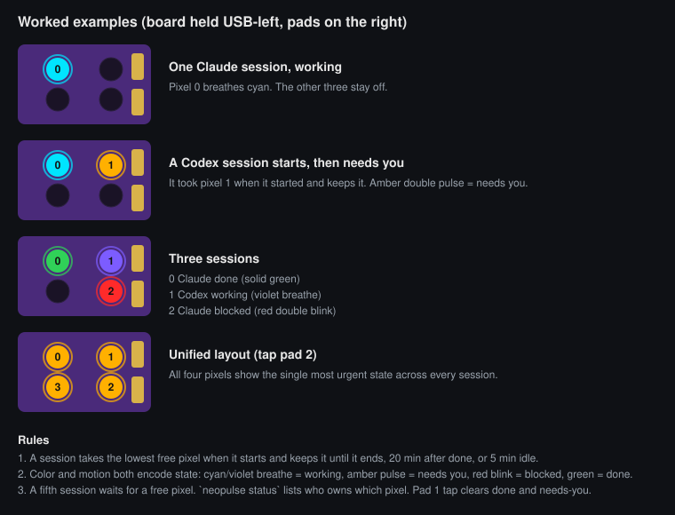
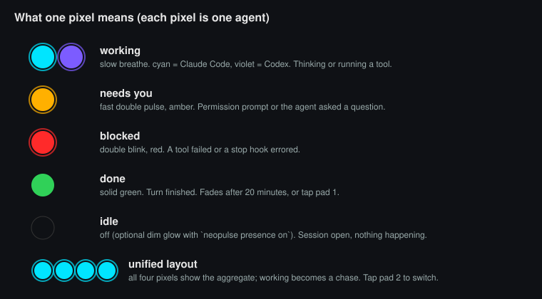
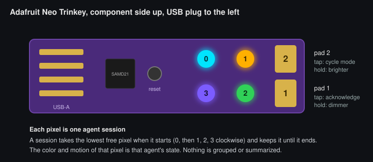

# NeoPulse

An open-source USB status light for AI coding agents, built on the $7 **Adafruit Neo Trinkey**
(4 NeoPixels, 2 touch pads) or any CircuitPython board with NeoPixels. Inspired by
[SidePulse](https://sidepulse.io) and compatible with its `LEDS.LED` program language.

Know whether Claude Code or Codex is **working**, **needs you**, is **blocked**, or **done**
without looking at the terminal.

## How to read it

**Each pixel is one agent session.** When a Claude Code or Codex session starts, it takes the
lowest free pixel (0, then 1, 2, 3, clockwise) and keeps it until the session ends. The color
and motion of that pixel is that agent's state. Nothing is grouped and nothing is summarized.
Four sessions fill the board; a fifth waits for a free pixel.





Prefer one big indicator? Tap pad 2 (or `neopulse mode unified`) and all four pixels show the
single most urgent state, SidePulse style. Tap again for off, again for back to one-per-agent.

`neopulse status` prints which pixel each session owns:

```
sessions 2   (one pixel per session; pixel 0 top-left, 1 top-right, 2 bottom-right, 3 bottom-left)
  pixel 0   working  claude  my-api        3s ago
  pixel 1   waiting  codex   frontend     41s ago
```

Try it without hardware: open [docs/simulator.html](docs/simulator.html) in a browser
(or the [live copy](https://htmlpreview.github.io/?https://github.com/gopikori/neopulse/blob/main/docs/simulator.html)).

### Pixels and pads



Hold the board component side up with the USB plug to the left. Numbers are the pixel indexes
used everywhere in NeoPulse (programs, `neopulse write 0:#ff0000`, the simulator). Pads carry
the numbers printed on the board.

```
            ┌──────────────────────────────────────┐
            │                      ┌───┐  ┌───┐   ┌─┐│
  USB ══════│   SAMD21   (reset)   │ 0 │  │ 1 │   │2││  pad 2  tap: cycle layout   hold: brighter
            │                      ├───┤  ├───┤   ├─┤│
            │                      │ 3 │  │ 2 │   │1││  pad 1  tap: acknowledge    hold: dimmer
            │                      └───┘  └───┘   └─┘│
            └──────────────────────────────────────┘
```

### States

| State | Pattern | Color |
|---|---|---|
| working / tool running | slow breathe (chase in unified) | cyan `#00e5ff` Claude, violet `#7c5cff` Codex |
| needs you | fast double pulse | amber `#ffb000` |
| blocked / error | double blink | red `#ff2a2a` |
| done | solid, fades after 20 min or when you tap pad 1 | green `#30d158` |
| idle | off (or a dim glow with `neopulse presence on`) | – |

Unified mode picks the most urgent state: blocked > needs you > working > done > idle.
Colors come from a JSON profile (`neopulse profile list`); `ember` and `mono` are included.

## Install

```bash
git clone https://github.com/<you>/neopulse && cd neopulse
python3 -m venv .venv && . .venv/bin/activate
pip install -e .
neopulse flash          # one time: puts CircuitPython + NeoPulse firmware on the Trinkey
neopulse setup          # installs Claude Code + Codex hooks and the background monitor
neopulse demo           # see every state
```

`neopulse flash` reboots the board into its UF2 bootloader (or asks you to double-tap the tiny
reset button), copies CircuitPython 10.3.1, then copies the firmware. Afterwards the board mounts as
`NEOPULSE`.

## Use it from anything

The device is a USB drive. Any script that can write a text file can drive the light:

```bash
echo "#30d158 400ms ease" > /Volumes/NEOPULSE/LEDS.LED              # solid green
printf 'off\n#ff3a00 1.6s pulse\nrepeat\n' > /Volumes/NEOPULSE/LEDS.LED   # pulse
```

Or with the CLI. `neopulse` alone prints the overview, `neopulse help <command>` the details:

```
Everyday
  neopulse status                 what the device, hooks, daemon and sessions are doing
  neopulse bright [60|up|down]    show or set brightness (or hold pad 1 / pad 2)
  neopulse ack                    clear done/waiting lights (or tap pad 1)
  neopulse mode lane|unified|off  layout (or tap pad 2)
  neopulse demo                   cycle through every state

Drive it yourself
  neopulse state waiting --session ci     feed a state from scripts, CI, cron
  neopulse write '#30d158 400ms ease'     raw LED program (see spec/PROTOCOL.md)
  neopulse off | identify | events | info
  neopulse profile use ember              color profiles; add JSON to ~/.config/neopulse/profiles
```

Every command works over the drive alone. Commands such as `bright` and `identify` go through
`CMD.TXT` when the serial port is busy (the daemon holds it), so nothing depends on serial.

Full language and serial protocol: [spec/PROTOCOL.md](spec/PROTOCOL.md).

## How agents connect

`neopulse hooks install claude` adds command hooks to `~/.claude/settings.json`
(SessionStart, UserPromptSubmit, PreToolUse, PostToolUse, PostToolUseFailure, Notification, Stop,
SessionEnd). `neopulse hooks install codex` adds `[[hooks.*]]` tables to `~/.codex/config.toml`
and pre-trusts them. Both merge with what you already have and keep a backup.

Each hook runs `hooks/entry.py`, which appends one JSON line to
`~/.local/state/neopulse/events.jsonl` and refreshes the device. It costs 30 to 90 ms, prints
nothing (hook stdout would leak into the model's context), and always exits 0.

The optional daemon (`neopulse monitor run`, or `monitor install-service` for launchd / systemd)
handles what hooks cannot: fading "done" after 20 minutes, dropping stale sessions, and the touch
pads (ack, layout cycling). Without it everything still works except those three.

## Architecture

```
firmware/          CircuitPython: boot.py, code.py, neopulse_fw.py (engine), boards/profile.py
spec/PROTOCOL.md   the contract between device and host
neopulse/
  program.py       parse / validate / build LED programs (pure Python, mirrors the firmware)
  device.py        find the NEOPULSE drive and the data serial port
  transport/       FileTransport, SerialTransport, NullTransport
  states.py        State, priority, Profile (JSON), lane + unified renderers
  monitor.py       event log → sessions → program → device; ack / clear / manual states
  hooks/           claude.py, codex.py installers; entry.py hook process
  cli.py           the `neopulse` command
tools/deploy.sh    mpy-cross build + copy to the board
```

Every layer is importable on its own: use `neopulse.program` + `FileTransport` for a plain blinky,
or `neopulse.states` to render your own state machine.

## Other hardware

Any CircuitPython board with NeoPixels: copy `firmware/boards/profile_generic_strip.py` to
`boards/profile.py` on the drive, set the pin and pixel count, done. The host adapts to `leds=N`.
Boards with more RAM can skip the `.mpy` step and run `neopulse_fw.py` as `code.py`.

## Troubleshooting

- **All four pixels solid white**: CircuitPython is idle, the firmware is not running. Run
  `neopulse reset` (the daemon also does this automatically) or replug the board.
- **Nothing lights up after a hook fires**: `neopulse status` shows the sessions it knows about and
  whether the daemon is running; `~/.local/state/neopulse/monitor.log` has the daemon's view;
  `neopulse info` reports `bright=` (hold pad 2 or run `neopulse bright 60` if it is low).
- **All pixels off, no white**: the layout is probably `off` (tapping pad 2 cycles lane, unified,
  off; the daemon flashes 1, 2 or 3 white pixels to show which one you landed on) or brightness is
  at the floor. `neopulse mode lane` and `neopulse bright 60` bring it back. The reset button
  restarts the firmware but does not change these, since they live on the host and in device NVM.
- **Hooks only load when an agent session starts**, so restart Claude Code / Codex after
  `neopulse hooks install`.

## Development

```bash
pip install -e ".[dev]"
pytest
tools/deploy.sh            # rebuild lib/neopulse_fw.mpy (needs tools/mpy-cross 10.3.1) and copy to the board
```

Changes to `boot.py` (drive label, `STATUS.TXT`, the second serial port) only apply on a real
power-on: unplug and replug the board. A reset from the REPL or `neopulse reset` reruns `code.py`
only.

Firmware debugging: the first USB serial port is the CircuitPython console; Ctrl-C shows where the
loop is, Ctrl-D reloads. Note this SAMD21 build lacks `str.encode`, `bytes.decode`, `str.partition`
and `json`.

MIT license.
